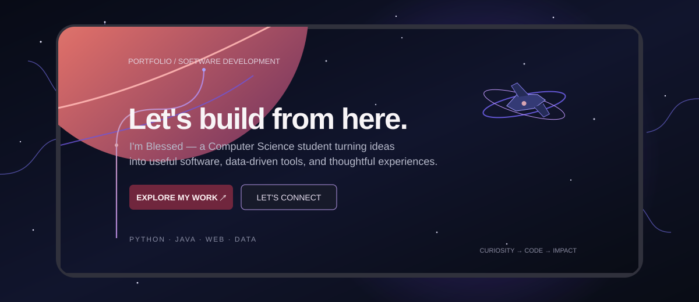

  

  
  

  
  

---

## `whoami` — A bit about me

Hey! I'm **Blessed Mazambani**, a **Computer Science student at Vishwakarma University, Pune**, working toward becoming a software developer.

I like building things that make concepts real: a website that feels intuitive, an application that organizes a process, or an analysis that turns raw data into something understandable. I'm still growing as a developer, and I treat each project as a chance to learn the tools *and* the reasoning behind them.

- 🎓 B.Sc. Computer Science
- 💻 Interested in software development, web applications, backend systems, and data analytics
- 🧠 Learning by building projects, debugging, and improving them iteratively
- 🌱 Currently strengthening Java, JavaScript, React, Spring Boot, SQL, and machine-learning fundamentals
- 🤝 Open to learning with other developers and collaborating on practical projects

> *Curiosity starts it. Consistency builds it. Feedback makes it better.*

## 🚀 Projects from my workbench

### 🌍 Crime Rate Analysis in India
A data-focused web application concept for exploring crime records geographically and identifying patterns through interactive maps and filters.

**What it brings together:** Python Flask API, MySQL, R Shiny, geographic visualisation, and data filtering.

### 🤝 Bro Up — Men's Mental Health & Awareness
A website concept for a men's mental health and awareness organisation, designed to make helpful information approachable and encourage men to speak openly and support one another.

**What I'm focusing on:** accessible content, thoughtful visual design, responsive layouts, and a supportive user experience.

### 📈 Retail Sales Performance Monitoring
A data analytics project exploring sales performance across products, countries, and time periods, with dashboards and forecasting to help make trends easier to understand.

**Tools used:** Python, pandas, scikit-learn, Excel, and Power BI.

### ⚡ Household Energy Consumption Analysis
A time-series project built around household electricity usage, with data cleaning, feature preparation, model experiments, and evaluation.

**Focus areas:** preprocessing, time-aware validation, forecasting, and clear visualisations.

### 🚌 Bus Boarding System
A Python desktop application that simulates passenger boarding and queue management, with a Tkinter interface and queue-based logic.

**Focus areas:** Python, object-oriented programming, data structures, and GUI development.

  

---

## 🧰 Tools I'm working with

  
  
  
  
  
  
  
  
  
  
  
  
  

🌱 Current learning: React · Spring Boot · stronger SQL · software design · machine-learning workflows

## 🧭 My current direction

<table>
  <tr>
    <td width="50%">
      <h3>Build</h3>
      Small, useful applications that combine interfaces, business logic, APIs, and databases.
    </td>
    <td width="50%">
      <h3>Understand</h3>
      Data structures, clean code, debugging, testing, and the decisions behind reliable software.
    </td>
  </tr>
  <tr>
    <td width="50%">
      <h3>Explore</h3>
      Data analysis and machine learning through real datasets and measurable evaluation.
    </td>
    <td width="50%">
      <h3>Improve</h3>
      Make projects clearer, more usable, better documented, and easier for someone else to run.
    </td>
  </tr>
</table>

---

## 📊 GitHub snapshot

  
  

  

## 📬 Find me on GitHub

  
  

Open to constructive feedback, project ideas, and opportunities to learn with others.

  

